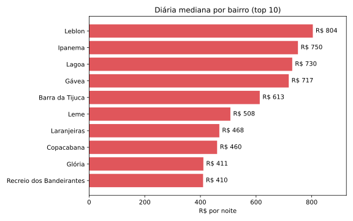
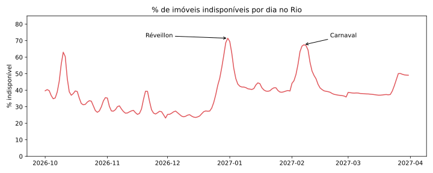
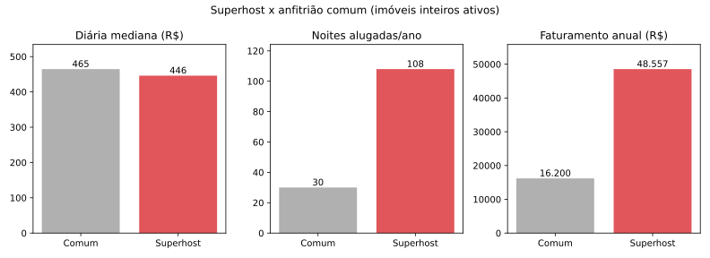

# Quanto vale ser Superhost? Airbnb no Rio de Janeiro

Análise de **27 mil anúncios ativos** do Airbnb no Rio de Janeiro, com dados públicos do [Inside Airbnb](https://insideairbnb.com/get-the-data/) (coleta de setembro de 2026).

**Ferramentas:** Python (pandas, matplotlib) · Jupyter Notebook

## Perguntas
1. Quais bairros têm a diária mais cara?
2. Quanto a procura sobe no Réveillon e no Carnaval?
3. Superhosts cobram mais caro ou alugam mais?
4. Onde vale mais a pena ter um imóvel no Airbnb?

## Principais resultados

**1. Leblon e Ipanema cobram quase o dobro de Copacabana**

**2. Réveillon e Carnaval são reservados com meses de antecedência:** 71% dos imóveis já estavam indisponíveis para 31/12, contra 27% num dia comum de dezembro.

**3. O Superhost não cobra mais caro, mas aluga cerca de 3x mais:** 108 noites por ano contra 30, com faturamento estimado 3 vezes maior.

**4. Para investir, olhe o faturamento e não só a diária:** Ipanema e Leblon lideram em faturamento; Gávea e Lagoa cobram caro, mas alugam pouco.

## Como reproduzir
1. Baixe `listings.csv.gz` e `calendar.csv.gz` do Rio de Janeiro em insideairbnb.com/get-the-data
2. Coloque os dois arquivos numa pasta `data/`
3. Rode o notebook `analise_airbnb_rio.ipynb`

Os arquivos `resumo_bairros.csv` e `ocupacao_por_dia.csv` já estão tratados e prontos para Power BI ou Looker Studio. A base completa de anúncios limpos (`anuncios_limpos.csv`) é gerada ao rodar o notebook.

## Limitações
- Ocupação e faturamento são **estimativas** do Inside Airbnb, feitas a partir das avaliações.
- "Indisponível" no calendário inclui reservas **e** datas bloqueadas pelo anfitrião.
- Superhost x ocupação é **correlação**: para ganhar o selo é preciso já ter várias estadias.

---
Amanda de Souza Santos · Biomédica em transição para Análise de Dados
